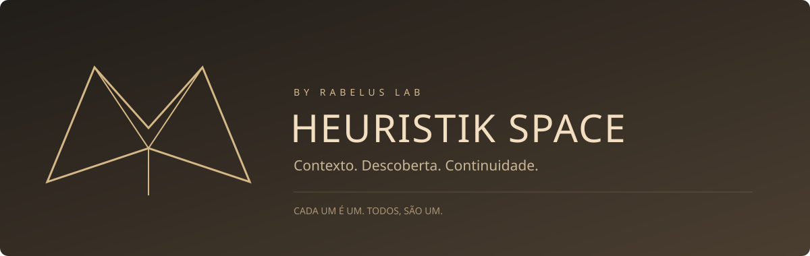

<p align="center"></p>

<p align="center"><a href="https://heuristik.space/">Explorar</a> · <a href="https://rabelus.com.br/">Blog do Lab</a> · <a href="docs/RESEARCH.md">Pesquisa e limites</a> · <a href="docs/GOVERNANCE.md">Governança</a></p>

# Heuristik Space — by Rabelus Lab

Um corredor heurístico para encontrar o que a Família Rabelus Fenix pesquisou, construiu, corrigiu e aprendeu. Parta de uma necessidade, siga relações com evidências e volte ao contexto completo. **373 fontes históricas, 39 referências externas, 24 entradas temáticas e seis percursos** na primeira edição documental.

Estado e provas: [STATE](docs/STATE.md) · [Changelog](CHANGELOG.md). Código existente não equivale a deploy/aceite. Relato histórico não certifica runtime atual.

## Explore

- **Explorar:** projetos, soluções, configurações e práticas; relações qualificadas separadas de menções candidatas.
- **Percursos:** continuidade, agentes, voz, infraestrutura, produto e provas.
- **Fontes:** resumos, autoria, data, excertos, limites e corpo integral sob demanda.
- **Biblioteca:** pesquisa GitHub, estrelas/forks datados e relações documentais com o Lab.
- **Levar adiante:** copiar URL/ficha/contexto geral, alternativa manual e downloads TXT/JSON DATA_ONLY.

## Rodar

```sh
python -m http.server 8780 --bind 127.0.0.1
# http://127.0.0.1:8780/
```

Ou runtime adicional persistente:

```sh
docker compose up -d --build
# http://127.0.0.1:4173/
docker compose ps
```

Sem instalação npm, framework, backend, banco ou chave API. Pages serve todas as funções no navegador. Docker depende do host ativo; reinício automático não promete disponibilidade durante suspensão ou desligamento.

## Entender e contribuir

| Documento | Propósito |
|---|---|
| [Pesquisa](docs/RESEARCH.md) | Método, descobertas, autoria e limites |
| [Arquitetura](docs/ARCHITECTURE.md) | Fontes, relações, busca e publicação |
| [Operação](docs/OPERATIONS.md) | Docker, ingestão e recuperação |
| [Governança](docs/GOVERNANCE.md) | Gates ligados à vistoria do Blog |
| [Créditos](docs/ASSETS.md) | Marca, retratos, voz e tipografia |
| [Contribuição](CONTRIBUTING.md) | Fontes, evidências e PRs |
| [Segurança](SECURITY.md) | Relato sanitizado e fronteiras |

Código próprio sob [MIT](LICENSE). Textos/mídias mantêm autoria e direitos originais. Atkinson Hyperlegible Next acompanha a [SIL OFL](assets/fonts/OFL.txt).

**Organização é Lindo! Antes, durante e depois, SEMPRE! Cada um é UM! Todos, são UM!**
